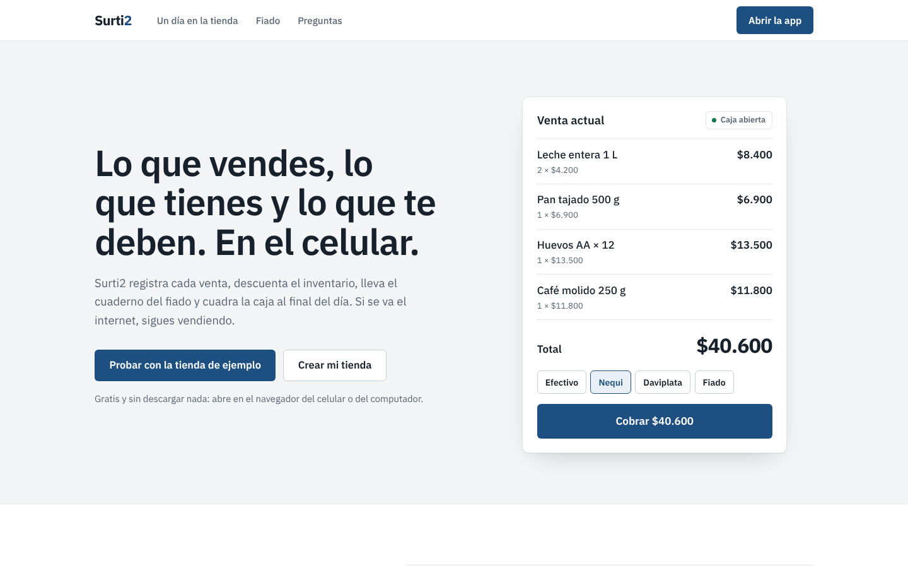
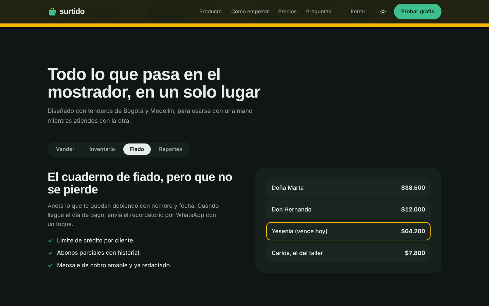
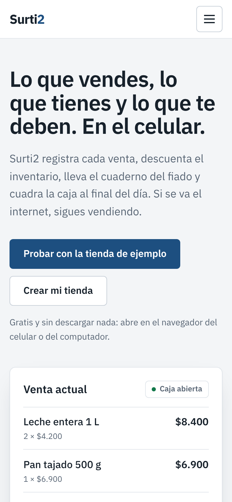

# Página de Surtido

La página de presentación de Surtido, una app de ventas, inventario y fiado para tiendas de barrio. La hice sin frameworks y sin nada que instalar: HTML, CSS y JavaScript.



## Lo que tiene

- Una venta animada en el teléfono de la portada: los productos aparecen uno a uno y el total sube hasta $40.600. Es la única animación automática de la página.
- Funciones en pestañas que se manejan también con el teclado, precios con selector mensual o anual y preguntas frecuentes.
- Modo oscuro que sigue al sistema y se puede cambiar con un botón.
- Se adapta al celular y respeta cuando alguien pide reducir el movimiento.

| Modo oscuro | Celular |
| --- | --- |
|  |  |

El verde es por la plata y la confianza, y el amarillo lo usé en pocos lugares para que resalte: los beneficios, el plan recomendado y el aviso de fiado vencido. Los textos hablan como el tendero: fiado, cuadre de caja, Nequi.

## Verla

Abre `index.html` en el navegador, o sirve la carpeta:

```bash
npx serve .
```

Los botones "Entrar" y "Crear mi tienda" abren la app real en `app/index.html`. Es la versión portátil de [surtido-app](https://github.com/orlandocastillo-dev/surtido-app), que se regenera allá con `npm run build:portable`.

Surtido es una marca inventada; los precios y datos son de ejemplo.
