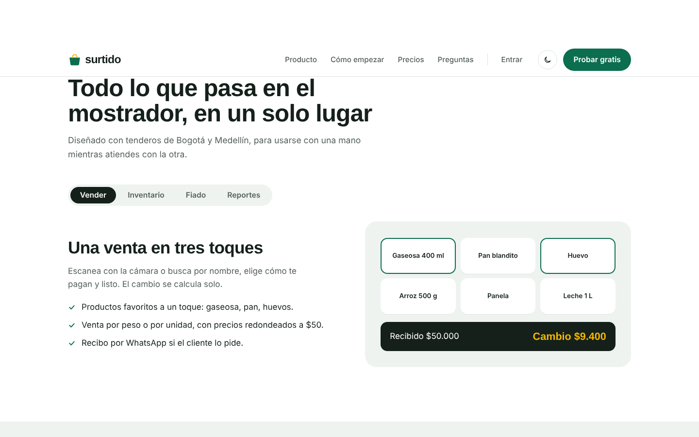

# Surtido: landing page en HTML, CSS y JavaScript puro

Landing page para **Surtido**, una app ficticia de ventas, inventario y fiado para tiendas de barrio en Colombia. Sigue la estructura clásica de las landings de producto SaaS (hero con demostración del producto, franja de beneficios, recorrido por funciones con pestañas, pasos, precios con selector de periodo, preguntas frecuentes y cierre), con contenido, marca y diseño propios.

El objetivo del proyecto es practicar maquetación sin frameworks: **cero dependencias, cero build**, solo HTML semántico, CSS moderno y JavaScript nativo.


## Qué demuestra

**HTML**
- Estructura semántica: `header`, `nav`, `main`, `section`, `article`, `footer`, listas ordenadas donde hay secuencia.
- Metadatos para buscadores y redes sociales (description, Open Graph, theme-color).
- Enlace "saltar al contenido" para navegación con teclado.

**CSS**
- Sistema de diseño con variables (`:root`) para color, tipografía, radios y espaciado.
- **Grid** para layouts de dos columnas, planes de precios, pasos y pie de página; **Flexbox** para alineaciones internas.
- Tipografía fluida con `clamp()` y contenedor con `min()`, sin media queries para cada tamaño.
- **Modo oscuro** que respeta la preferencia del sistema y se puede forzar con un botón (se recuerda en `localStorage`).
- Selectores modernos: `:has()`, `color-mix()`, `mask` con SVG embebido para los íconos de check.
- Animación de entrada del hero hecha solo con CSS (`animation-delay` calculado con una variable por fila).
- Respeta `prefers-reduced-motion`.

**JavaScript**
- Menú móvil con `aria-expanded`, cierre con Escape y al pasar a escritorio.
- **Pestañas accesibles** siguiendo el patrón WAI-ARIA: roles `tablist` / `tab` / `tabpanel`, navegación con flechas, Inicio y Fin.
- Selector mensual / anual que recalcula precios con `Intl.NumberFormat` en formato colombiano.
- Acordeón de preguntas con `aria-controls` y `hidden`.
- Contador animado del total en el teléfono del hero con `requestAnimationFrame` y easing.

| Modo oscuro | Móvil |
| --- | --- |
|  |  |



## Estructura

```
.
├── index.html
├── css/styles.css     # tokens, base, componentes, secciones y responsive
├── js/main.js         # un módulo por interacción
├── img/favicon.svg
└── docs/              # capturas para este README
```

## Conexión con la app

Los botones "Entrar", "Crear mi tienda" y "Probar" abren la **app real** (proyecto `06-app-surtido-react-redux`) en `app/index.html`, donde se crea la cuenta y se inicia sesión. Es una versión portátil de la app en un solo archivo: funciona con doble clic, sin servidor y sin internet.

Si cambias algo en la app, regenera esa copia desde la carpeta del proyecto 06:

```bash
npm run build:portable
```

## Cómo verlo

No necesita instalación. Abre `index.html` en el navegador, o sirve la carpeta para probarlo como en producción:

```bash
npx serve .
# o
python -m http.server 8000
```

Para publicarlo gratis: GitHub Pages (Settings, Pages, rama `main`), Netlify o Vercel arrastrando la carpeta.

## Decisiones de diseño

- **El producto es el protagonista del hero.** En lugar de una ilustración genérica, el hero muestra una venta real registrándose en el teléfono: los productos aparecen uno a uno, el total cuenta hasta $40.600 y se confirma la venta. Es la única animación automática de la página.
- **Paleta** verde profundo (confianza, dinero) con amarillo caléndula como acento de señalización. El amarillo se usa en pocos lugares para que destaque: la franja de beneficios, el plan recomendado y la alerta de fiado vencido.
- **Tipografía:** Bricolage Grotesque para titulares, con carácter y algo de calidez; Instrument Sans para lectura.
- Los textos usan el vocabulario del público: *fiado*, *cuadre de caja*, *tendero*, *Nequi*.

## Rendimiento y accesibilidad

- Sin librerías de JavaScript: unos 6 KB de código propio, sin minificar.
- Contraste AA en ambos temas.
- Todo es operable con teclado y tiene foco visible.

---

Proyecto de portafolio de Orlando Castillo. Surtido es una marca ficticia; los precios y datos son de ejemplo.
